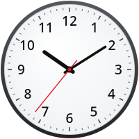
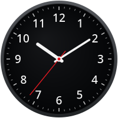
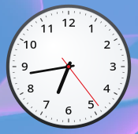
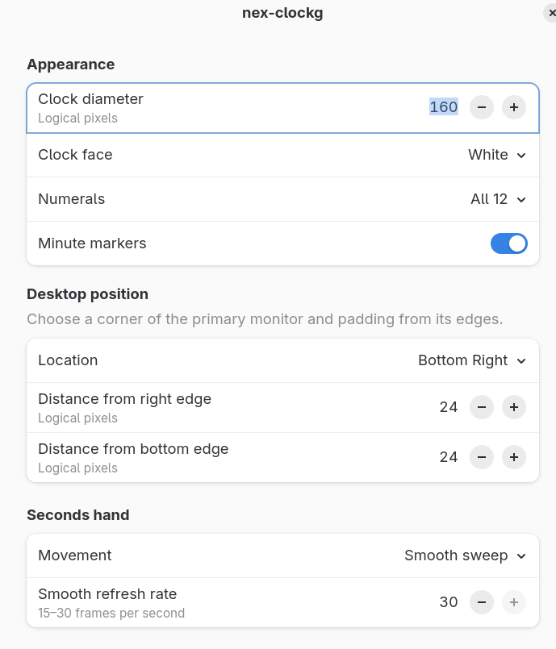

# nex-clockg

A standalone GNOME Shell desktop analog clock. The face contains no branding.
By default it draws above the wallpaper and below application windows on the primary monitor.
Enable Always on Top to keep it visible above normal application windows.
Simple Clock and other installed extensions are left untouched.




These two images are deterministic Cairo renderer previews, not desktop captures.
See [verification notes](docs/VERIFICATION.md) for the runtime test scope.

## Screenshots



The clock on the desktop with a white face, all twelve numerals, minute markers,
a dark gray bezel, black hour and minute hands, and a red seconds hand.



The preferences dialog shows a 160-logical-pixel white clock with all twelve
numerals and minute markers enabled. It is positioned in the bottom-right corner
with 24 logical pixels of padding from the right and bottom edges. The seconds
hand is configured for a smooth sweep at 30 frames per second.

This preferences screenshot predates the Always on Top switch. The current
version also includes that switch under Desktop position; it defaults to Off.

## Compatibility

The extension allows GNOME Shell 50 and 51. Fedora 44 / GNOME Shell 50.6 is
runtime-tested. Fedora 45 / GNOME Shell 51 is enabled in metadata at the user's
request, but no GNOME 51 runtime is available here to verify behavior.

## Install

Required runtime components: GNOME Shell 50 or 51, GJS, GTK4 and libadwaita.
Packaging requires Python 3 and `glib-compile-schemas` (Fedora `glib2`).
No root access or system-wide configuration changes are needed.

From `/home/rczys/Applications/nex-clockg`:

```sh
./scripts/install.sh
```

Log out and back in so Shell discovers the extension, then run:

```sh
gnome-extensions enable nex-clockg@greenfinch628.github.io
gnome-extensions prefs nex-clockg@greenfinch628.github.io
```

The UUID is `nex-clockg@greenfinch628.github.io`. Installation writes only its
own directory under `${XDG_DATA_HOME:-$HOME/.local/share}/gnome-shell/extensions`.
The installer builds the ZIP first and backs up any previous installation of
this UUID under the user data directory's `nex-clockg/backups` folder.

Alternatively, install the packaged ZIP with:

```sh
gnome-extensions install dist/nex-clockg@greenfinch628.github.io.shell-extension.zip
```

Use the script above for recoverable updates. After updating, log out and back
in to load the new JavaScript; then enable the extension if needed. Existing
clock settings persist. To disable it:

```sh
gnome-extensions disable nex-clockg@greenfinch628.github.io
```

## Preferences

| Preference | Default | Choices |
| --- | --- | --- |
| Diameter | 200 logical px | 120–400 |
| Face | White | White / black |
| Numerals | All 12 | All 12 / 12, 3, 6, 9 |
| Seconds movement | Smooth | Smooth / tick |
| Smooth refresh rate | 30 FPS | 15–30 FPS |
| Minute markers | On | On / off |
| Always on Top | Off | Off / on |
| Location | Top Right | Top Left / Top Right / Bottom Left / Bottom Right |
| Padding | 24 px horizontally and vertically | 0–4000 logical px from selected corner |

Changes apply immediately and are stored in the extension's own GSettings path,
`/org/gnome/shell/extensions/nex-clockg/`. The selected corner and padding use the primary monitor's
work area and follows work-area and monitor changes. Offsets are clamped to the
available area. The widget is not draggable and does not intercept desktop clicks.
It hides in overview and on the lock screen. Application windows cover it when Always on Top is Off (the default for both new
and existing installations). Switching this preference reparents the same actor
immediately, preserving position, size, appearance and saved settings. On places
it above normal windows but below Shell chrome and modal/top windows. Both modes
hide during overview and lock; neither intercepts clicks. GNOME 51 is allowed but remains
unverified at runtime.

Logical pixels scale with the desktop. St.DrawingArea supplies the scale-aware
Cairo context; the renderer does not apply a second monitor scale.

Each frame reads the system clock directly, including fractional seconds in
smooth mode. Tick mode recomputes the next real second boundary after every
callback. Neither mode accumulates an artificial clock time. Timers resume from
current wall time after suspend or time adjustments. Animation stops when the
actor is unmapped or explicitly hidden. A window covering the widget does not
currently suspend its animation.

60 FPS is intentionally omitted: 30 FPS is the tested initial target, and there
is no comparative performance evidence yet to justify the additional redraws.

## Development and packaging

```sh
./scripts/check.sh
./scripts/package.sh
```

The first command validates schemas and JS syntax, tests clock math and scheduling,
renders both themes at five sizes and two scales, and builds the ZIP under `dist/`.
The ZIP contains only runtime files, schema source and compiled schema, and license.

The optional GNOME 50 integration test requires a functioning headless Mutter
backend, Python PyGObject, a session D-Bus daemon, GTK4 and libadwaita:

```sh
./tools/shell-session.sh
```

It creates private XDG data/config/runtime directories under `/tmp`, starts a
separate headless Shell and tests settings, actual repaint rates, overview behavior,
cleanup, and preferences. A temporary helper extension enables Shell Eval only
inside that isolated session. The helper is never included in the release ZIP.
`./tests/persistence.sh` separately verifies settings across private dconf sessions.

The integration test stops its Shell on exit and retains its temporary logs for inspection.

## Release

Version 1.1.0 is prepared locally. Repository:
`greenfinch628/nex-clockg`. Nothing is published automatically.
Review `docs/VERIFICATION.md`, complete the outstanding platform checks, and obtain
explicit approval before GitHub publication or release creation.

License: MIT.
